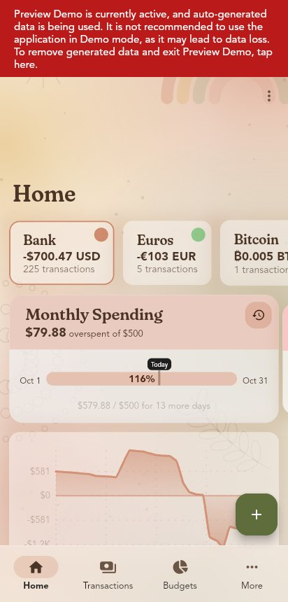
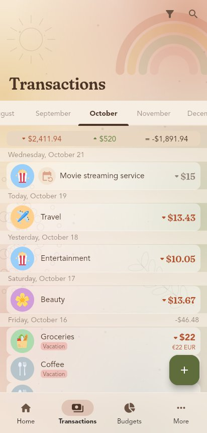
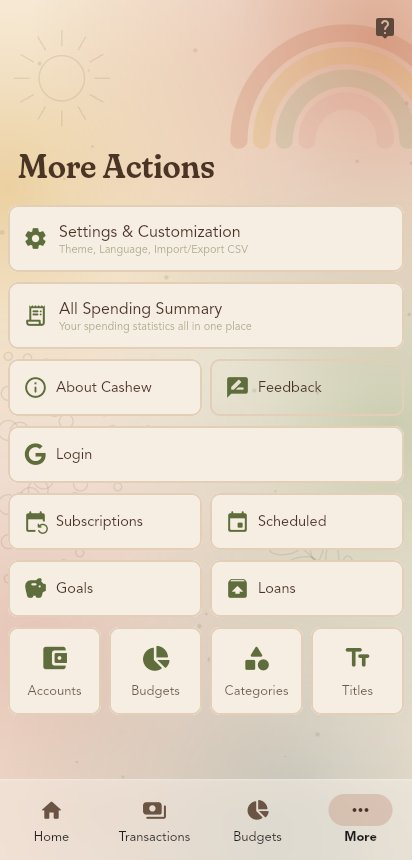
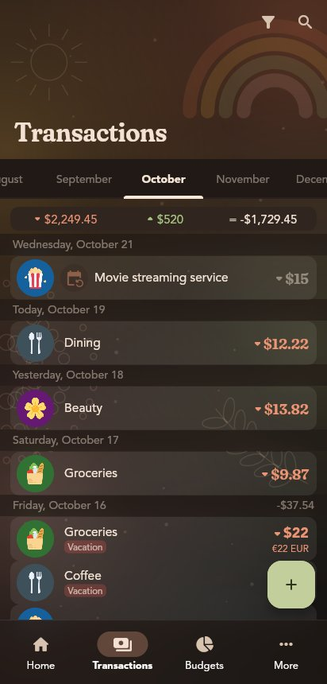
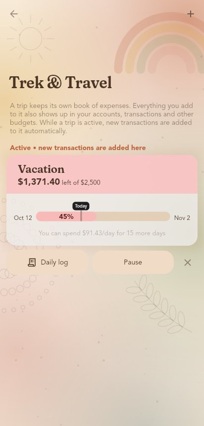
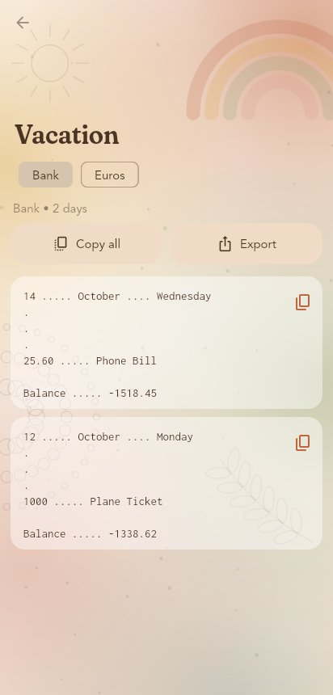
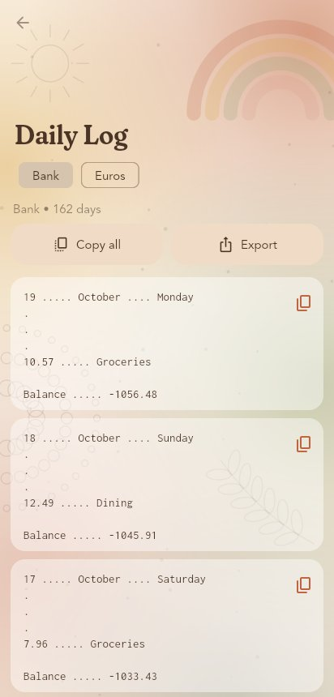

<h1 align="center">CashEW</h1>

<p align="center">
  A community fork of <a href="https://github.com/jameskokoska/Cashew">Cashew</a>, the open source budget tracker,
  with every <b>Cashew Pro</b> feature unlocked and no in-app purchases.
</p>

---

CashEW is built on the work of [James Kokoska](https://github.com/jameskokoska), the author of Cashew.
Cashew is licensed under the GNU GPL v3, and so is this fork. The full upstream history is kept in this
repository, and the original README is in [`docs/UPSTREAM_README.md`](docs/UPSTREAM_README.md).

If you find the app useful, consider supporting the original developer by buying Cashew Pro on
[Google Play](https://play.google.com/store/apps/details?id=com.budget.tracker_app) or the
[App Store](https://apps.apple.com/us/app/cashew-expense-budget-tracker/id6463662930).

## What is different from Cashew

| | Cashew | CashEW |
|---|---|---|
| Multiple budgets | Pro | Free |
| Multiple goals and long term loans | Pro | Free |
| Past budget periods / budget history | Pro | Free |
| All-time spending history graph on accounts | Pro | Free |
| Custom colour picker | Pro | Free |
| "Upgrade" screen after adding transactions | Yes | No |
| Google Play Billing / StoreKit | Yes | Removed |
| Backend | Developer's Firebase project | None by default, bring your own |
| Android application id | `com.budget.tracker_app` | `io.github.maaariyo.cashewew` |

Everything else (transactions, subscriptions, debts and credits, multiple currencies and accounts,
category limits, CSV and Google Sheets import, notifications, home screen widgets, biometric lock,
Material You theming, app links) is unchanged upstream code.

The different application id means CashEW installs alongside Cashew. To move your data, use
*Export Cashew Data File* (Settings → Import & Export) in Cashew, then *Import Cashew Data File* in CashEW.

## Boho Glass design

CashEW ships with its own look: an earthy bohemian palette (terracotta, mustard, sage, dusty rose,
cream and cocoa), hand-drawn line art (rainbow arches, sun, leaves, mandala dots) painted behind every
page, frosted-glass cards, app bars, date headers and navigation bar, and headings set in
[Fraunces](https://github.com/undercasetype/Fraunces) (SIL Open Font License) with its soft axis turned up.

| Home | Transactions | More | Dark |
|---|---|---|---|
|  |  |  |  |

- Turn it off in *Settings → Boho Glass* to get the original Cashew design back.
- With *Battery Saver* on, the palette stays but blur and the decorated backdrop are skipped.
- All of it lives in `budget/lib/struct/bohoGlass.dart`, with small hooks in the theme, page
  framework, navigation bar and text widgets.

## Trek & Travel

*More Actions → Trek & Travel.* A trip has its own book of expenses, but every transaction in it is a
normal transaction, so it still shows up in your accounts, the transactions list and your other budgets.

- **Plan a trip** with a name, dates and a trip budget, or turn an existing "added transactions only"
  budget into a trip.
- While a trip is **active**, the Add Transaction page puts new transactions on it automatically
  (change the budget chip to opt out). It stops after the trip's end date; *Pause* stops it earlier.
- Each trip shows Cashew's budget card (tap it for categories, history and spending graphs) and has
  its own **Daily log**.
- Under the hood a trip is a budget that only counts transactions added to it. The list of trips is
  kept in settings, which are stored in the database and included in backups, so there is no
  database schema change.

## Daily Log

*More Actions → Daily Log* (all expenses) or *Daily log* on a trip (only that trip's expenses).
There is one log per account (fund), and one block per day with logged expenses. Each block has a
copy button, and *Copy all* / *Export* give every day of the account as text (oldest first, days
separated by a blank line):

```
16 ..... October .... Friday
.
.
.
250 ..... Taxi to airport
1200.50 ..... Hotel

Balance ..... 8549.50
```

- Amounts are plain numbers: no currency sign or thousands separators. Whole amounts have no
  decimals, others use the account's decimals.
- An activity's name is the transaction title, or its category if the title is empty.
- Transfers and balance corrections are not listed as activities. Income isn't either, but both
  count towards the balance.
- **Balance** is the account's balance at the end of that day, including everything in the account
  (also outside the trip). Only paid transactions count, as in the rest of the app.

| Trek & Travel | Trip daily log | Daily Log |
|---|---|---|
|  |  |  |

## How the paywall worked

See [`docs/PAYWALL_ANALYSIS.md`](docs/PAYWALL_ANALYSIS.md) for the full write-up. In short, every
Pro check in Cashew goes through a single function, `hidePremiumPopup()` in
`budget/lib/pages/premiumPage.dart`, which returns `true` when a purchase id is stored locally. CashEW
replaces that file with no-op shims that keep the same names, so upstream call sites still merge
cleanly.

## Getting the app

APKs are built by GitHub Actions on every push (see the **Build** workflow, artifact `cashew-ew-apk`)
and attached to a GitHub release when a `v*` tag is pushed.

Pick `app-arm64-v8a-release.apk` for almost any phone made after 2017, or `app-release.apk`
(universal) if unsure.

> **Signing:** unless the `KEYSTORE_*` secrets below are set, each CI run is signed with a new
> throwaway key, so a newer APK will not install over an older one. Set up a signing key before
> you rely on updates.

## Building locally

Requirements: Flutter **3.19.6** (upstream pins `intl 0.18.1`, which newer Flutter versions reject),
JDK 17 and the Android SDK (platform 34).

```bash
cd budget
flutter pub get
flutter build apk --release
# or with your own Firebase project:
flutter build apk --release --dart-define-from-file=firebase.env.json
```

Without a `android/key.properties` the release build is signed with the debug key.

## Cloud features

CashEW does not use the original developer's Firebase project or Google OAuth clients. Out of the box
the app is fully offline: local backups, CSV import and export all work.

| Feature | Needs |
|---|---|
| Google Drive backup and cross-device sync | A Google Cloud OAuth client for your package name and signing SHA-1 |
| Shared budgets, in-app feedback | Your own Firebase project with Firestore |

Setup steps are in [`docs/FIREBASE.md`](docs/FIREBASE.md).

## CI secrets

| Secret | Purpose |
|---|---|
| `KEYSTORE_BASE64` | `base64 -w0 release.jks` of your upload/signing keystore |
| `KEYSTORE_PASSWORD`, `KEY_ALIAS`, `KEY_PASSWORD` | Keystore credentials |
| `FIREBASE_ENV_JSON` | Contents of your `firebase.env.json` (optional) |

## Keeping up with upstream

The upstream history is preserved, so new Cashew releases merge directly:

```bash
git remote add upstream https://github.com/jameskokoska/Cashew.git
git fetch upstream
git merge upstream/main
```

Conflicts in `budget/lib/pages/premiumPage.dart` should always be resolved by keeping the CashEW
version. If upstream adds a new Pro gate, add a matching no-op shim there.

## Licence and trademarks

GPL-3.0, same as upstream; see [`LICENSE`](LICENSE). The GPL covers the code, not the Cashew name or
logo. If you plan to publish CashEW on an app store, change the name and icon first.
